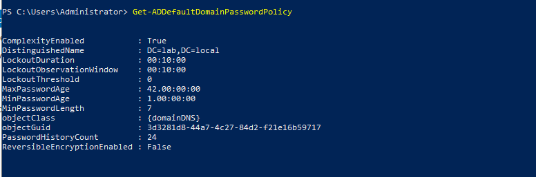
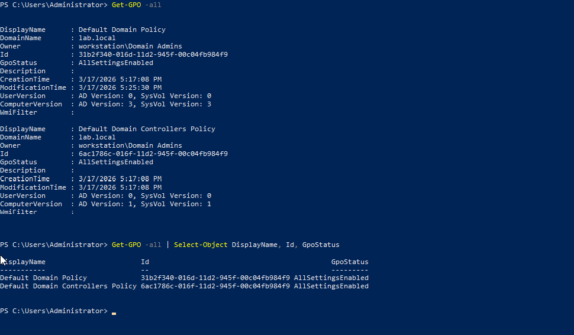
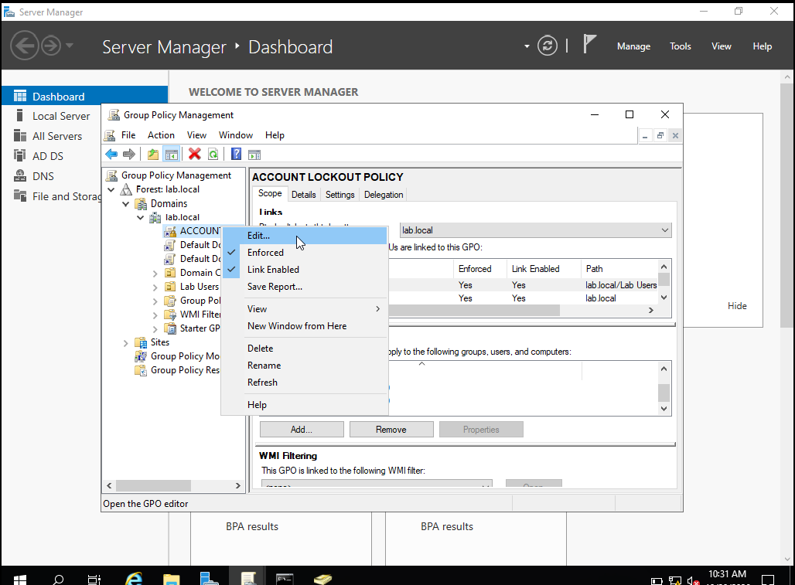
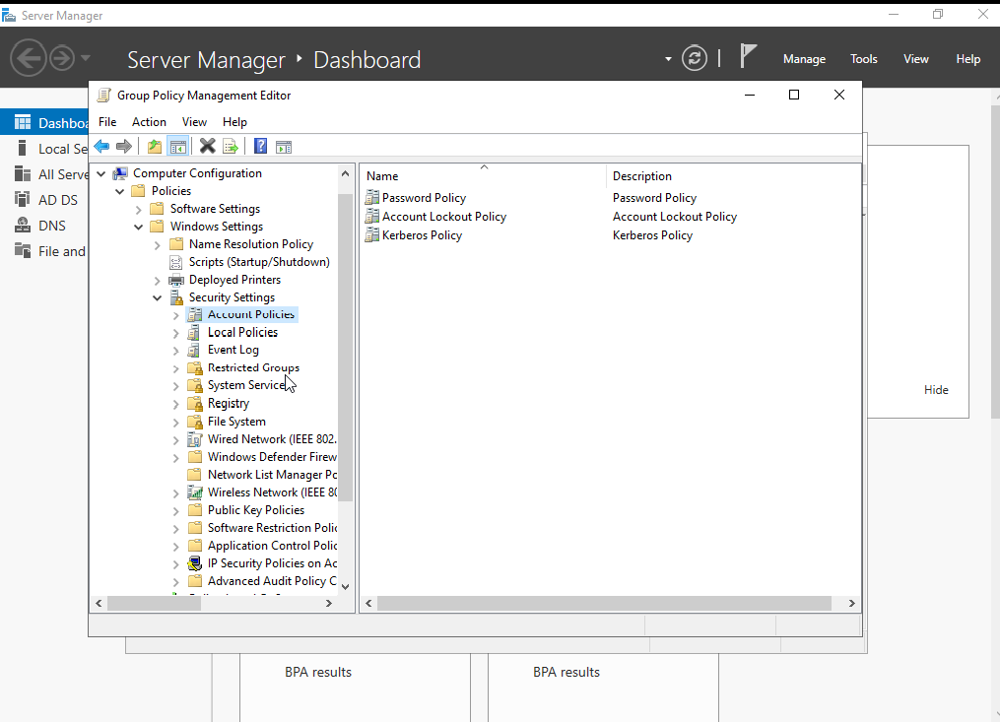
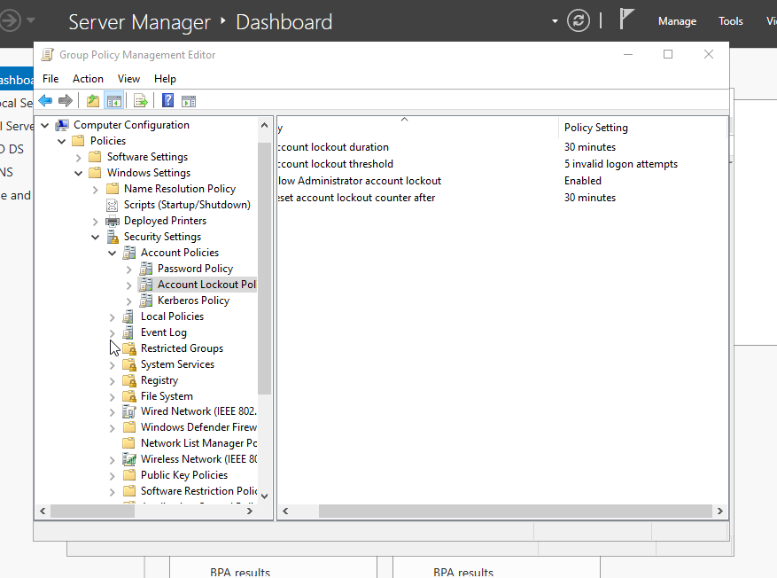
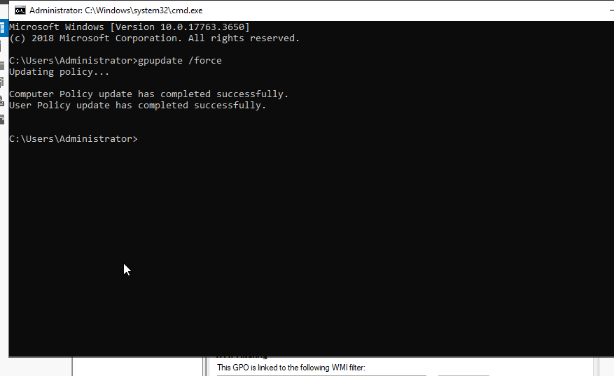
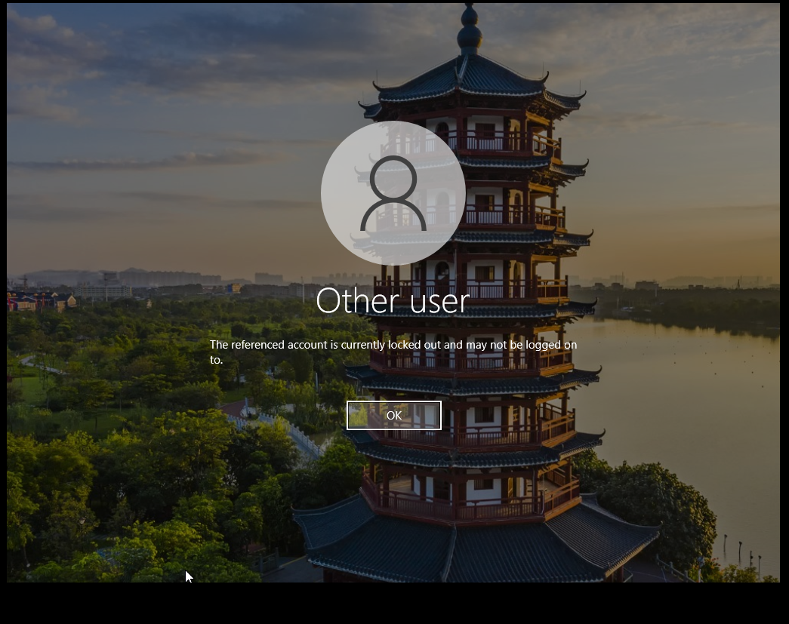
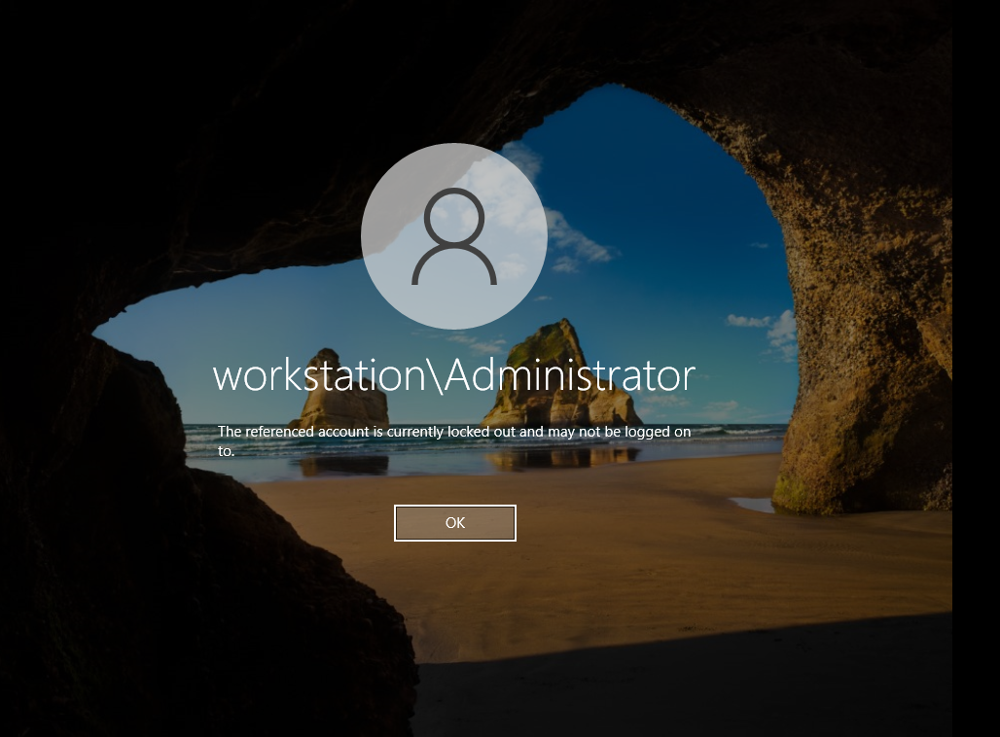

# Configuring windows lockout-out policy

## 1. Baseline the account lockout policy

Before changing any policy, recorded the existing domain default:

```powershell
Get-ADDefaultDomainPasswordPolicy |
  Select-Object MinPasswordLength,
                PasswordHistoryCount,
                ComplexityEnabled,
                LockoutThreshold,
                LockoutDuration,
                LockoutObservationWindow
```




Also inspect Group Policy objects and links:

```powershell
Get-GPO -All | Select-Object DisplayName, Id, GpoStatus
Get-GPInheritance -Target "DC=lab,DC=local"
```



For the default domain account lockout policy, the effective domain-level policy is especially important. Domain account lockout settings are normally configured in a GPO linked at the domain level. Fine-grained password policies can apply to particular users or groups and can override the default domain password policy for those accounts. We'll assess that separately before testing.

## 2. Creating `Access Management Policy`

I created a password policy using a template i got from `sans.org`

Full policy here: [Access policy](access_management_policy.docx)

## 3. Implement the account lockout policy

After the domain and client pass their verification checks, the next phase is to:

1. Create a new GPO in the Target OU. for the sake of this Lab, the OU created was `Lab Users`. Give the new GPO a name `ACCOUNT LOCKOUT POLICY`

2. After creating the GPO, hover over the newly created GPO and click on edit.

    

3. Following the folder structure below, select `Account Policies`, then `Account Lockout Policy`.

    

4. Edit the parameters accordingly.

    

5. Spawn a command prompt shell and update group policy using `gpupdate /force`

    


Account lockout can reduce repeated password guessing but can also be abused to deny a legitimate user access. Treat a lockout event as an investigation signal, not conclusive proof of malicious activity.

## 4. Testing Implementation

Test 1



Test 2



## 5. Troubleshooting checklist

### Client cannot find the domain

- Confirm both VMs use the VirtualBox Internal Network named exactly `intnet`.
- Confirm each VM's network adapter is enabled and connected.
- Verify `CLIENT01` uses `192.168.56.10` as its DNS server.
- Run the domain SRV `Resolve-DnsName` command on the client.
- Confirm the DNS and Netlogon services are running on `DC01`.
- Check system time on both machines; Kerberos authentication is sensitive to clock skew.

### Domain join fails

- Verify DNS resolution before retrying the join.
- Confirm the domain name is exactly `lab.local`.
- Verify the joining account has permission to join a computer.
- Inspect the error message and relevant client logs.
- Check for duplicate or stale computer accounts if a previous join was attempted.

### Group Policy does not apply

- Run `gpupdate /force` on the client.
- Run `gpresult /r` and, if needed, generate an HTML report:

  ```powershell
  gpresult /h "$env:USERPROFILE\Desktop\gpresult.html"
  ```

- Check GPO links, security filtering, OU placement, and replication status if more than one domain controller exists.

### DNS or AD DS checks fail

- Confirm the static IP configuration and DNS server address.
- Inspect `DNS`, `NTDS`, and `Netlogon` service status.
- Run `dcdiag` and review the specific failing test.
- Check Event Viewer for DNS Server, Directory Service, and System events.
- Do not work around domain discovery problems by hard-coding domain-controller IP addresses in application settings; fix DNS first.

